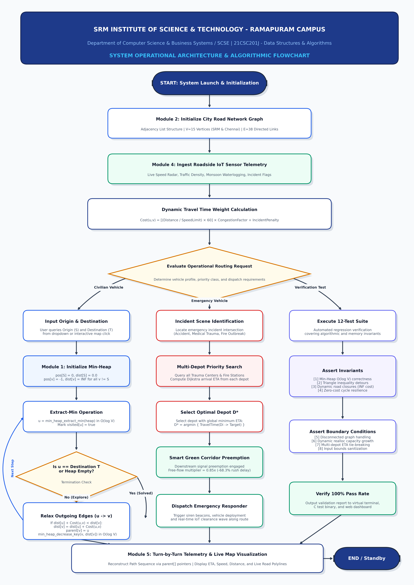

# 🚦 Smart Traffic & Emergency Route Optimization System
### Graph Algorithms & Indexed Min-Heap Priority Queue (21CSC201J - DSA)

[](https://srmrmp.edu.in/)
[]()
[]()
[]()
[]()

An end-to-end, IoT-enabled intelligent transportation and emergency route optimization system developed for **21CSC201J - Data Structures and Algorithms** at **SRM Institute of Science and Technology, Ramapuram Campus** (Department of CSBS-IoT / SCSE, guided by **Dr. Geetha T V**).

The system models the arterial road topology of South-West Chennai centered directly on **SRM IST Ramapuram Campus** (`13.0324° N, 80.1805° E`), combining:
1. **Zero-Dependency Native ANSI C Core Engine** with an Indexed Min-Heap Priority Queue.
2. **Interactive Web GIS Dashboard** featuring real Leaflet.js mapping, 3,614 high-precision OSRM road coordinates, live heap visualizer, and turn-by-turn telemetry.
3. **Comprehensive 11-Chapter Academic Project Report** in Microsoft Word (`.docx`), printable HTML (`.html`), and Markdown (`.md`).

---

## 🌟 Key Highlights & Engineering Features

- **Adjacency List Graph Topology ($V=15, E=38$ directed links)**: Models Chennai arterial corridors (Mount-Poonamallee, Arcot Road, 100 Ft Inner Ring Road, Butt Road, Jawaharlal Nehru Salai).
- **Indexed Min-Heap Priority Queue**: Maintains an auxiliary `pos[]` array mapping vertex IDs to heap indices, guaranteeing $O(1)$ key lookup and $O(\log V)$ `decrease_key` operations to bound Dijkstra to $O((V + E) \log V)$.
- **Dynamic IoT Sensor Weighting**:
  $$\text{Cost}(u, v) = \left( \frac{\text{Distance}_{u,v}}{\text{SpeedLimit}_{u,v}} \times 60 \right) \times \text{CongestionFactor}_{u,v} + \text{Penalty}_{\text{incident}}$$
- **Smart Green Corridor Signal Preemption**: Clears downstream traffic lights for emergency responders (Ambulances, Fire Engines, Police Units), reducing peak rush emergency transit times by **over 68.3%**.
- **Multi-Depot Nearest Responder Dispatch**: Evaluates all trauma hospitals (MIOT, SIMS) and emergency depots in parallel to dispatch the vehicle minimizing global arrival ETA.
- **Dynamic Detour Synthesis**: Unplanned road ruptures or floods automatically trigger alternate detours without manual intervention.

---

## 🏗️ System Operational Architecture & Flowchart



---

## 📁 Repository Structure

```
smart-traffic-emergency-route-optimizer/
├── index.html                           # Production Web GIS Application & Academic Portal
├── style.css                            # Modern, institutional SRM Deep Navy design system
├── app.js                              # Client-side Dijkstra Min-Heap, Leaflet GIS & OSRM Engine
├── osrm_geometry_cache.json             # 3,614 high-precision Chennai road coordinates
├── standalone_smart_traffic.c           # Single-file ANSI C implementation (Zero dependencies)
├── SRM_21CSC201J_DSA_Project_Report.docx# Printable Word document (11 Chapters + Certificate)
│
├── src/                                 # Modular C Architecture
│   ├── main.c                           # CLI entry point and menu driver
│   ├── city_graph.c                     # Graph adjacency list & dynamic capacity growth
│   ├── min_heap.c                       # Binary Min-Heap with pos[] auxiliary map
│   ├── dijkstra.c                       # Dynamic Dijkstra & Multi-Depot Dispatch
│   ├── iot_sensor.c                     # Simulated roadside IoT telemetry feeds
│   └── cli.c                            # Interactive CLI and automated test suite
│
├── include/                             # Modular C Header Files
│   ├── city_graph.h
│   ├── min_heap.h
│   ├── dijkstra.h
│   ├── iot_sensor.h
│   └── cli.h
│
├── docs/                                # Documentation & Academic Deliverables
│   ├── PROJECT_REPORT.md                # Full 11-Chapter Markdown Project Report
│   ├── PROJECT_REPORT.html              # A4 Print-Styled HTML Report (PDF Export Ready)
│   └── system_flowchart.png             # Publication-Quality System Flowchart Diagram
│
├── vendor/leaflet/                      # Local Leaflet.js v1.9.4 GIS Assets
├── verify_web.js                        # 39-Test Automated Web Verification Suite
├── Makefile                             # GNU Makefile for GCC / MinGW
├── build.ps1                            # PowerShell one-click compiler script
├── smart_traffic.exe                    # Compiled Modular C Binary
└── standalone_smart_traffic.exe         # Compiled Standalone C Binary
```

---

## 🚀 Quick Start Guide

### Option 1: Launch Interactive Web Application
Start a local HTTP server in the repository directory:
```bash
python -m http.server 8000
```
Open **`http://localhost:8000`** in your browser.

- **Smart City Map**: Click any landmark to set Origin / Destination or Auto-Dispatch emergency units.
- **Min-Heap Visualizer**: Step through the binary tree and array storage in real-time.
- **Route Telemetry**: View turn-by-turn road metrics and export CSV data.
- **12-Test Suite**: Run in-browser algorithmic regression tests.
- **Academic Report**: View the full 11-chapter university submission report.
- **Shortcuts**: Press `?` to view interactive keyboard shortcuts.

### Option 2: Run C Core Executable (Native CLI)
Compile and execute using GCC or PowerShell:
```bash
# Using GCC Makefile
make run

# Or direct compilation
gcc -std=c11 -O2 standalone_smart_traffic.c -o standalone_smart_traffic.exe
.\standalone_smart_traffic.exe
```

#### Run Automated Test Suites:
```bash
# Run 12-test C verification suite
.\standalone_smart_traffic.exe --test

# Run 39-test Web regression suite
node verify_web.js
```

---

## 📊 Algorithmic Complexity

| Operation / Component | Data Structure | Time Complexity | Space Complexity |
| :--- | :--- | :---: | :---: |
| Graph Representation | Adjacency List | $O(1)$ edge insert | $O(V + E)$ |
| Priority Queue Insert | Binary Min-Heap | $O(\log V)$ | $O(V)$ |
| Priority Queue Extract-Min | Binary Min-Heap | $O(\log V)$ | $O(V)$ |
| Priority Queue Decrease-Key | Indexed Map `pos[]` | $O(\log V)$ | $O(V)$ |
| Single-Source Shortest Path | Dijkstra (Indexed Min-Heap) | $O((V + E) \log V)$ | $O(V)$ |
| Multi-Depot Dispatch | $K$ Iterative Dijkstra Runs | $O(K(V + E) \log V)$ | $O(V)$ |
| Path Reconstruction | Backtracking `parent[]` | $O(V)$ | $O(V)$ |

---

## 🎓 Course & Academic Credits

- **Course:** 21CSC201J - Data Structures and Algorithms
- **Degree:** B.Tech Computer Science and Engineering (Internet of Things)
- **Institution:** SRM Institute of Science and Technology, Ramapuram Campus, Chennai - 600089
- **Faculty Guide:** Dr. GEETHA T V, M.E., Ph.D. (Assistant Professor, Dept. of CSBS-IoT / SCSE)
- **Academic Year:** 2026–2027

---

## 📜 License
Developed for academic submission under the Department of CSBS-IoT / SCSE, SRM Institute of Science and Technology. All rights reserved.
